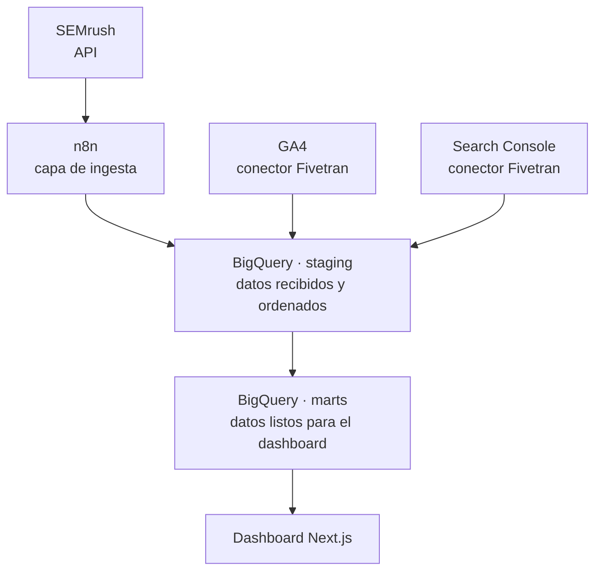

# Dashboard SEO de NUTEC — Léeme primero

**Última actualización: 16 de noviembre de 2026**
**Para:** todas las personas que se integran al proyecto — analítica, desarrollo y cuenta.

Este es el primero de seis documentos. Explica qué estamos construyendo, por qué, cómo está organizado y quién hace qué. No tiene código ni SQL. Los demás profundizan para cada equipo:

| Orden | Documento | Para quién | Qué contiene |
|---|---|---|---|
| 1 | `00_LEEME_Dashboard_SEO_NUTEC.md` | todos | este documento: visión general |
| 2 | `01_Analitica_Modelo_Datos_BigQuery.md` | equipo de analítica | cómo entran los datos, cómo se guardan y cómo se calcula cada métrica |
| 3 | `02_Integracion_SEMrush_n8n.md` | Roberto | cómo se construye el flujo que lleva las posiciones de SEMrush a BigQuery |
| 4 | `03_Especificacion_Vistas.md` | Dilan, desarrollo y Claude Code | qué muestra cada pantalla del dashboard |
| 5 | `04_Publicacion_y_Acceso.md` | Dilan y desarrollo | hospedaje, acceso con Clerk, costos y pasos para publicar el dashboard |
| 6 | `CLAUDE.md` | desarrollo y Claude Code | cómo se construye y se presenta la aplicación |

Si una palabra no te resulta conocida, está definida en el **Glosario** al final de este documento. Está pensado para que nadie tenga que adivinar qué significa un término.

---

## 1. Qué estamos construyendo

**NUTEC** es un fabricante de fibra cerámica y aislamiento térmico de alta temperatura, con plantas en Carolina del Norte (Estados Unidos) y Ramos Arizpe (México). **Julius** es la agencia que lleva su estrategia de posicionamiento orgánico en Google (SEO) para el mercado de Estados Unidos.

Hoy la información sobre cómo le va a NUTEC en Google está repartida en tres herramientas distintas, cada una con su propia interfaz y sus propias definiciones. Para responder una pregunta tan básica como "¿la página de mantas está atrayendo más visitas desde que la optimizamos?", alguien tiene que abrir las tres, exportar datos y cruzarlos a mano.

El proyecto consiste en una **aplicación web que reúne las tres fuentes en un solo lugar** y permite recorrer los datos desde la vista del sitio completo hasta el detalle de una sola búsqueda. Se construye en **Next.js** con el sistema de diseño **BoardUI** (en su versión gratuita y con su apariencia por defecto), y lee sus datos de **Google BigQuery**, que funciona como el almacén central de datos.

Existe un antecedente: un tablero en HTML que se hizo para probar la idea con datos de posiciones. Sirvió para descubrir qué información resulta útil y qué errores de cálculo hay que evitar. No se va a reutilizar su código, pero varias de las reglas que aparecen en estos documentos salieron de ahí.

---

## 2. El principio que guía todas las decisiones

> **El dashboard refleja lo que dicen Google Search Console y Google Analytics 4. No los reinterpreta.**

La persona que más va a usar el dashboard del lado del cliente también tiene acceso directo a Search Console y a Google Analytics. Si abre las dos herramientas y ve un número distinto al de nuestro dashboard, la primera reacción razonable es desconfiar del dashboard, y una vez perdida esa confianza es muy difícil recuperarla.

Por eso, en este proyecto **no reconstruimos ni modelamos los datos de Google por nuestra cuenta**. Siempre que es posible tomamos el dato ya procesado por Google, que es exactamente el mismo que el cliente ve en sus pantallas. Cuando hay que sumar o combinar datos, lo hacemos de la misma forma en que lo hace la herramienta de origen.

Este principio decide muchas cosas que en otro proyecto serían opinables. Si en algún momento dudas sobre cómo calcular algo, la pregunta correcta casi siempre es: **¿cómo lo calcula la herramienta de origen?**

---

## 3. Las tres fuentes de datos

Cada fuente responde una pregunta distinta. Ninguna sustituye a las otras.

**Google Search Console** responde *¿cómo nos ve Google en los resultados de búsqueda?* Mide cuántas veces apareció un resultado de NUTEC en Google (impresiones), cuántas veces alguien le dio clic (clics) y qué porcentaje de las apariciones terminó en clic (CTR). Lo hace para todas las búsquedas reales que hizo la gente, no para una lista predefinida.

**Google Analytics 4 (GA4)** responde *¿qué pasa cuando la gente llega al sitio?* Mide visitas (sesiones), personas (usuarios), si interactuaron con la página o se fueron de inmediato (engagement y rebote), y qué acciones completaron (eventos, como enviar un formulario).

**SEMrush** responde *¿en qué lugar aparecemos para las búsquedas que más nos importan?* A diferencia de Search Console, no mide todas las búsquedas: revisa todos los días una lista fija de **65 búsquedas** elegidas por la estrategia de SEO y registra en qué posición aparece NUTEC en Google para cada una. También registra si Google citó a NUTEC dentro de su respuesta generada con inteligencia artificial.

**Desde cuándo hay datos de cada fuente:**

| Fuente | Primer día con datos |
|---|---|
| Search Console | 1 de enero de 2026 |
| Google Analytics 4 | 1 de enero de 2026 |
| SEMrush | 4 de agosto de 2026 |

Esto tiene una consecuencia importante: **de enero a julio de 2026 hay datos de búsqueda y de visitas, pero no de posiciones.** Ese periodo funciona como la línea base de cómo estaba NUTEC antes de que arrancara el seguimiento de posiciones. Cuando alguien seleccione un rango que incluya esos meses, el dashboard debe dejar claro que la posición no estaba medida todavía, en lugar de mostrar un cero o una línea vacía.

---

## 4. Cómo se navega el dashboard: de lo general a lo particular

El dashboard está organizado en cuatro niveles. Cada uno permite bajar al siguiente para ver el detalle.

**Sitio.** La vista completa de nutec.com: cuánta búsqueda atrae, cuántas visitas genera, cómo están las posiciones en conjunto.

**Cluster.** Un cluster es un grupo de búsquedas relacionadas que comparten una misma intención y que la estrategia de SEO asigna a una página específica del sitio. Por ejemplo, el cluster "Categoría Blankets" agrupa 21 búsquedas sobre mantas de aislamiento de alta temperatura, y su página destino es la categoría de mantas del sitio. Hoy existen tres clusters: **HOME**, **Categoría Blankets** y **MaxWool 2300**. El cluster es la pieza que permite unir las tres fuentes, porque conecta búsquedas (SEMrush) con páginas (Search Console y GA4).

**Página.** Una URL concreta del sitio, con sus impresiones, clics, visitas y las búsquedas rastreadas que la hacen aparecer en Google.

**Keyword.** Una búsqueda individual, con su posición día por día y su desempeño en Search Console.

No todas las fuentes existen en todos los niveles:

| Nivel | Search Console | GA4 | SEMrush |
|---|---|---|---|
| Sitio | sí | sí | sí |
| Cluster | sí | sí | sí |
| Página | sí | sí | sí |
| Keyword | sí | **no** | sí |

GA4 no registra con qué búsqueda llegó cada visita, así que **no existe información de visitas a nivel keyword**. El dashboard no debe inventarla ni estimarla.

Tampoco toda página pertenece a un cluster. Hay artículos del blog de NUTEC que aparecen en Google para búsquedas de varios clusters a la vez, y hay páginas con visitas que no pertenecen a ninguno. El dashboard debe mostrar esas páginas en un grupo visible de "sin cluster", no esconderlas.

---

## 5. Arquitectura en una página

Los datos viajan de izquierda a derecha y de arriba abajo, en cuatro etapas.

**Las fuentes.** Cada herramienta entrega sus datos por una vía distinta, elegida con una sola regla: *si Google ya entrega el dato con su procesamiento aplicado, se toma así; si no, se pide por su interfaz de programación (API), que sí lo entrega procesado.* Search Console ya llega procesado a través de un conector llamado **Fivetran**, que el equipo de analítica ya dejó funcionando. GA4 también entra por un conector de Fivetran, que sincroniza sus informes por día (decisión del 6 de noviembre de 2026, que reemplaza a la consulta de la Data API desde n8n; estado del conector: [por confirmar con analítica]). GA4 tiene además una exportación directa a BigQuery, pero entrega eventos sin procesar y no se usa. SEMrush no tiene exportación directa, así que se usa su API.

**La capa de ingesta.** Para la fuente que se pide por API (SEMrush) usamos **n8n**, una herramienta de automatización que consulta la API de forma programada y escribe los resultados en BigQuery. La frecuencia de SEMrush está por decidirse porque define su costo (ver Decisiones abiertas). Funciona como intermediario. Search Console y GA4 no pasan por n8n porque Fivetran ya escribe directamente en BigQuery.

**El almacén.** BigQuery guarda los datos en dos capas separadas. **Staging** guarda lo que llegó de cada fuente, ordenado y con formatos consistentes. **Marts** guarda tablas preparadas específicamente para el dashboard. La separación existe para que, si una fuente cambia el nombre de un campo, el problema se arregle en staging sin que el dashboard se entere.

**El dashboard.** La aplicación solo lee de marts. Nunca consulta staging ni las tablas de origen.

**Lo que no está en el diagrama, a propósito:** GA4 puede exportar sus eventos sin procesar directamente a BigQuery. No forma parte de esta arquitectura porque esos eventos no traen el procesamiento de Google y el dashboard no los necesita. Si esa exportación ya está activada, se puede dejar corriendo como reserva para análisis futuros, pero no alimenta ninguna cifra del dashboard.

El documento `01_Analitica_Modelo_Datos_BigQuery.md` describe cada etapa en detalle.

---

## 6. Quién hace qué

| Persona o equipo | Organización | Rol en el proyecto |
|---|---|---|
| **Dilan** | Julius · Líder de MarTech | Responsable del proyecto. Define alcance, toma decisiones de método y valida con el cliente. |
| **Equipo de analítica** (Pablo) | Julius | Conecta las fuentes (los conectores de Fivetran para Search Console y GA4), diseña y mantiene BigQuery, migra lo que se conserva de Supabase. |
| **Roberto** | Julius | Construye el flujo de n8n que lleva las posiciones de SEMrush a BigQuery, incluida la recarga del histórico. |
| **Equipo de desarrollo** | Julius | Construye la aplicación en Next.js, apoyándose en Claude Code. |
| **Yari** | NUTEC | Usuaria principal del dashboard. Es quien va a comparar nuestras cifras contra Search Console y GA4. |
| **Gerardo** | NUTEC | Decisor ejecutivo. Recibe presentaciones de resultados. |
| **Consultores Web** | Proveedor de NUTEC | Hacen los cambios técnicos en el sitio. No participan en el dashboard, pero sus cambios al sitio se reflejan en los datos. |

Toda la comunicación del proyecto es en **español**. Las búsquedas que se rastrean están en **inglés** porque el mercado es Estados Unidos, y así se muestran en el dashboard.

---

## 7. Decisiones ya tomadas

Estas decisiones ya se discutieron y tienen una razón concreta. No se reabren sin un motivo nuevo.

**El dashboard refleja las cifras de Google; no las reconstruye.** Para que coincidan con lo que el cliente ve en sus herramientas.

**Search Console y GA4 entran por Fivetran; SEMrush entra por API mediante n8n.** Es la aplicación de la regla de la sección 5. (Actualizado el 16 de noviembre de 2026: antes GA4 entraba por API mediante n8n; se cambió al conector de Fivetran el 6 de noviembre.)

**Las vistas de GA4 muestran solo el tráfico que llega desde búsqueda orgánica.** Es un dashboard de SEO; no hay opción de ver el total (decisión registrada en `03_Especificacion_Vistas.md`, sección 4.2; movida aquí desde las decisiones abiertas el 16 de noviembre de 2026).

**Usuarios de GA4 no se muestra.** Los usuarios no se pueden sumar entre días y el conector entrega informes diarios, así que la cifra de un rango no coincidiría con GA4 (decisión del 6 de noviembre de 2026).

**Hay dos posiciones, siempre separadas y rotuladas con su fuente.** Arriba, en el resumen, va la "Posición promedio · Search Console", que es la que el cliente ve en su herramienta. En el desglose por clusters va la "Posición rastreada · SEMrush", que sigue las 65 búsquedas elegidas. Miden cosas distintas y casi nunca coinciden, así que nunca se ponen juntas ni se comparan.

**La posición de una búsqueda se resume con la mediana, no con el promedio.** Un solo día atípico distorsiona el promedio; la mediana describe mejor dónde está realmente.

**Un dato que no se midió nunca se muestra como cero.** Se muestra como "sin medir". Un cero afirmaría algo que no sabemos.

**La interfaz usa BoardUI, solo su versión gratuita y con su apariencia por defecto.** Es un sistema de diseño para dashboards que ya resuelve la consistencia visual. Las gráficas que en BoardUI son de pago se construyen a mano con la misma apariencia.

**Supabase deja de usarse.** Hasta ahora las posiciones se guardaban en una base de datos en Supabase. Esa información se traslada a BigQuery y Supabase se da de baja.

---

## 8. Decisiones abiertas

Las dos primeras decisiones de esta lista tienen una propuesta concreta en `03_Especificacion_Vistas.md`, junto con otras de diseño de las vistas.

**¿Quién es el usuario principal del día a día?** Si es Yari revisándolo a diario o semanalmente, el dashboard debe priorizar el detalle y las alertas. Si es Gerardo en revisiones mensuales, debe priorizar las tendencias y los resúmenes. Intentar las dos cosas a la vez suele producir un dashboard que no sirve bien para ninguna.

**¿Las vistas de Search Console muestran todos los países o solo Estados Unidos?** Search Console muestra todos los países por defecto, y reflejarlo así es coherente con el principio del proyecto. Pero la estrategia de SEO está enfocada en Estados Unidos. Hoy el dashboard muestra todos los países; falta confirmar con NUTEC cuál es la vista por defecto.

**¿Con qué frecuencia se actualizan las posiciones?** SEMrush cobra por búsqueda consultada, no por día, así que la frecuencia decide el costo: actualizar a diario consume unas 390,000 unidades de API al mes; una vez por semana, unas 56,000. Los datos son diarios en ambos casos; cambia con cuánto retraso llegan al dashboard. Va de la mano con la primera decisión de esta lista: un uso diario justifica más frecuencia que uno mensual. El detalle está en `02_Integracion_SEMrush_n8n.md`.

---

## 9. Glosario

**AI Overview / citación en IA.** El resumen generado con inteligencia artificial que Google muestra arriba de algunos resultados de búsqueda. Decimos que NUTEC fue "citada en IA" cuando Google la menciona como fuente dentro de ese resumen.

**API.** Interfaz de programación. Es la puerta por la que un sistema le pide datos a otro de forma automática.

**Base comparable.** Cuando se compara un periodo contra otro, solo se toman en cuenta los elementos que existen en ambos periodos. Así, si entra una búsqueda nueva en mala posición, no "empeora" el promedio de un periodo sin que nada haya empeorado realmente.

**BigQuery.** El almacén de datos de Google donde se guarda toda la información del proyecto.

**Clics.** Veces que alguien le dio clic a un resultado de NUTEC en Google. Viene de Search Console.

**Cluster.** Grupo de búsquedas relacionadas que comparten intención y que la estrategia asigna a una página específica del sitio.

**Cobertura o visibilidad.** De cuántos días en los que se midió una búsqueda, en cuántos apareció NUTEC entre los primeros 100 resultados. En el dashboard se llama "Días en top 100" y se escribe "18 de 22".

**CTR.** Porcentaje de impresiones que terminaron en clic. Se calcula como clics divididos entre impresiones.

**Engagement (tasa de).** Porcentaje de visitas en las que la persona interactuó con la página: estuvo más de 10 segundos, vio más de una página o completó una acción importante. Viene de GA4.

**Evento clave.** Una acción que NUTEC considera valiosa, como enviar un formulario de contacto. GA4 los cuenta por separado.

**Fivetran.** Herramienta que copia automáticamente los datos de Search Console y de GA4 a BigQuery.

**Impresiones.** Veces que un resultado de NUTEC apareció en una página de resultados de Google, aunque nadie le haya dado clic.

**Keyword.** Una búsqueda concreta que la gente escribe en Google, como "ceramic fiber blanket".

**Keyword primaria, secundaria y variante.** Dentro de cada cluster, las búsquedas tienen tres niveles de importancia. La **primaria** es la más importante, y hay exactamente una por cluster. Las **secundarias** son búsquedas relevantes con intención distinta. Las **variantes** son formas diferentes de escribir la misma búsqueda (por ejemplo, "high temp" y "high temperature"). Estos roles vienen de etiquetas asignadas en SEMrush.

**Marts.** La capa de BigQuery con las tablas preparadas para el dashboard. Es lo único que la aplicación consulta.

**Mediana.** El valor del medio cuando se ordenan todos los datos de menor a mayor. Si una búsqueda estuvo en las posiciones 7, 7, 9, 9, 10, 45 y 45 a lo largo de una semana, la mediana es 9: eso describe mejor dónde está que el promedio, que daría 18.9 por culpa de dos días atípicos.

**n8n.** Herramienta de automatización que consulta la API de SEMrush de forma programada y escribe los resultados en BigQuery.

**Posición.** El lugar en que aparece NUTEC en los resultados de Google para una búsqueda. La posición 1 es el primer resultado. En este proyecto hay dos: la **posición promedio** de Search Console, sobre todas las búsquedas reales, y la **posición rastreada** de SEMrush, sobre 65 búsquedas elegidas.

**Rebote (tasa de).** En GA4, el porcentaje de visitas sin engagement. Es lo opuesto a la tasa de engagement. **No es el mismo concepto** que la tasa de rebote de la versión anterior de Google Analytics, y conviene aclararlo si el cliente compara contra reportes antiguos.

**Sesión.** Una visita al sitio. Una misma persona puede tener varias sesiones.

**SERP.** La página de resultados que muestra Google después de una búsqueda.

**Sin medir (s/m).** Indicador que el dashboard muestra cuando un dato no se midió en el periodo elegido. Se usa en lugar de un cero, porque un cero afirmaría algo que no sabemos.

**Staging.** La capa de BigQuery que guarda los datos tal como llegaron de cada fuente, ordenados y con formatos consistentes.

**Supabase.** La base de datos que se usó hasta ahora para guardar las posiciones. Se da de baja como parte de este proyecto.

**Usuario activo.** Una persona distinta que visitó el sitio en el periodo. Es la definición de "usuario" que usa GA4 por defecto.
